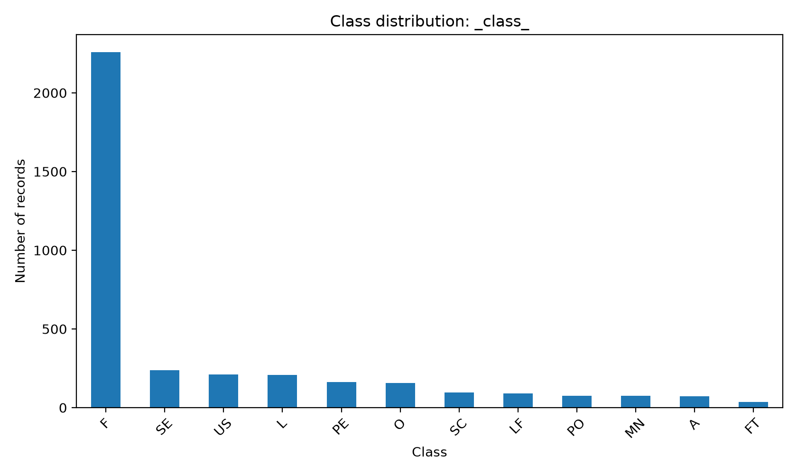
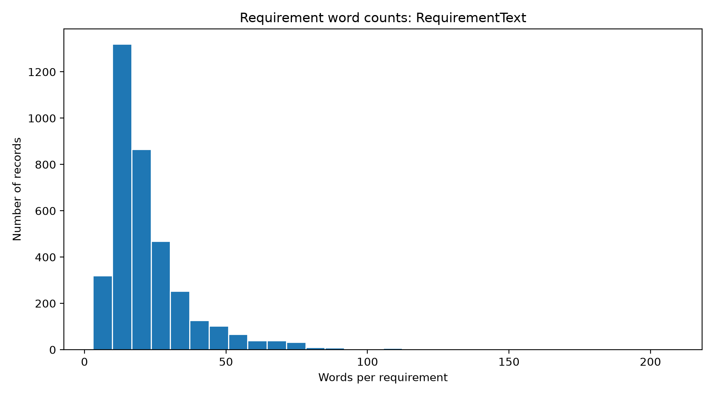

# PROMISE+ Requirements Analysis

**Exploratory Data Analysis and Machine Learning Research for Software Requirements Engineering**

This repository contains research work focused on analyzing and preparing the PROMISE+ software requirements dataset for machine learning-based requirements classification and further investigation of requirements quality and inconsistency.

The project follows a structured research workflow, beginning with dataset validation and exploratory data analysis (EDA), followed by preprocessing, model development, and evaluation.

## 1. Research Objectives

The primary objectives of this research are:

- Explore and analyze the PROMISE+ requirements dataset.
- Identify data-quality issues, duplicate requirements, and potential annotation inconsistencies.
- Examine requirement class distribution and class imbalance.
- Analyze linguistic characteristics and requirement lengths.
- Prepare a reproducible dataset-processing workflow.
- Develop and evaluate machine learning approaches for software requirements classification.
- Investigate approaches for detecting potential inconsistencies in software requirements.

**Research status:** Phase 1, Dataset Exploration, has been completed. Further preprocessing and model development are planned.

## 2. Dataset Information

The project uses the PROMISE+ software requirements dataset, provided in ARFF format.

| Property | Description |
|---|---|
| Dataset | PROMISE+ |
| Format | ARFF |
| Total requirements | 3,677 |
| Unique projects | 88 |
| Dataset attributes | 3 |
| Requirement categories | 12 |
| Missing values | 0 |
| Blank requirement texts | 0 |

### Dataset Attributes

| Attribute | Description |
|---|---|
| `ProjectID` | Identifier of the software project |
| `RequirementText` | Natural-language software requirement |
| `_class_` | Classification label assigned to the requirement |

The dataset contains the following requirement categories:

`F`, `A`, `L`, `LF`, `MN`, `O`, `PE`, `SC`, `SE`, `US`, `FT`, `PO`

The original dataset is preserved in `dataset/Promise+.arff`. A structurally repaired copy is generated for analysis.

## 3. Repository Structure

```text
PROMISE_Requirements_Analysis/
│
├── dataset/
│   ├── Promise+.arff
│   └── Lista dos tipos de software.xlsx
│
├── Docs/
│   └── Thesis_Intro+LiteratureReview.pdf
│
├── promise_exploration_phase_1/
│   ├── scripts/
│   │   ├── 00_inspect_escapes.py
│   │   ├── 00_validate_arff.py
│   │   ├── 01_load_dataset.py
│   │   ├── 02_dataset_overview.py
│   │   ├── 03_data_quality.py
│   │   ├── 04_class_distribution.py
│   │   ├── 05_text_analysis.py
│   │   ├── 06_duplicate_label_analysis.py
│   │   ├── 07_generate_eda_report.py
│   │   ├── common.py
│   │   └── dataset_utils.py
│   │
│   ├── outputs/
│   │   ├── figures/
│   │   ├── reports/
│   │   ├── tables/
│   │   └── validated/
│   │
│   ├── code_outputs.txt
│   ├── README.md
│   ├── requirements.txt
│   └── requirements.lock.txt
│
└── README.md
```

## 4. Phase 1: Dataset Exploration

Phase 1 focuses on understanding dataset structure, validating the ARFF file, investigating data-quality issues, and generating statistical summaries and visualizations.

### 4.1 Dataset Validation and Repair

The original ARFF dataset contained formatting issues that prevented direct loading using the Python ARFF parser.

The validation process identified and corrected:

| Repair type | Count |
|---|---:|
| Missing-comma repairs | 969 |
| Legacy punctuation replacements | 50 |
| Unique modified source lines | 969 |
| Successfully parsed records | 3,677 |

The punctuation replacements were inferred from apparent legacy Windows-1252 character representations.

All modifications were applied to a separate working copy.

**Validated dataset:** `promise_exploration_phase_1/outputs/validated/Promise+_repaired.arff`

**Repair audit:** `promise_exploration_phase_1/outputs/reports/arff_repair_audit.csv`

The original dataset remains unchanged.

### 4.2 Dataset Quality Analysis

| Metric | Result |
|---|---:|
| Total requirements | 3,677 |
| Unique requirement texts | 3,580 |
| Missing values | 0 |
| Blank requirement texts | 0 |
| Exact duplicate excess records | 21 |
| Normalized duplicate excess records | 113 |
| Distinct repeated texts across projects | 89 |
| Text groups with conflicting labels | 4 |
| Records involved in label conflicts | 8 |

Duplicate counts depend on the comparison method. Normalized duplicates are identified using case and whitespace normalization.

Four normalized-text groups were assigned multiple requirement-class labels. These cases have been flagged for manual review, with their original annotations preserved.

Such disagreements may reflect classification ambiguity or annotation inconsistencies. They do not, by themselves, demonstrate semantic contradictions between software requirements.

### 4.3 Requirement Class Distribution

The dataset contains 12 observed requirement categories.

| Class | Count | Percentage |
|---|---:|---:|
| F | 2,258 | 61.41% |
| SE | 237 | 6.45% |
| US | 212 | 5.77% |
| L | 209 | 5.68% |
| PE | 163 | 4.43% |
| O | 157 | 4.27% |
| SC | 95 | 2.58% |
| LF | 89 | 2.42% |
| PO | 76 | 2.07% |
| MN | 75 | 2.04% |
| A | 71 | 1.93% |
| FT | 35 | 0.95% |

Functional requirements (`F`) account for 61.41% of the dataset. The smallest class (`FT`) accounts for only 0.95%.

This imbalance will be considered during future model development and evaluation.



### 4.4 Requirement Text Analysis

The analysis examines the length of software requirements using character counts and whitespace-based word counts.

| Statistic | Characters | Words |
|---|---:|---:|
| Mean | 142.85 | 22.69 |
| Standard deviation | 101.72 | 16.18 |
| Minimum | 26 | 3 |
| 25th percentile | 78 | 13 |
| Median | 112 | 18 |
| 75th percentile | 169 | 27 |
| Maximum | 1,136 | 208 |

The median requirement contains 18 words, while the maximum contains 208 words.



## 5. Technologies and Libraries

The project uses Python for data analysis and visualization.

Main technologies include:

- Python
- pandas
- NumPy
- liac-arff
- Matplotlib
- Seaborn

Exact project dependencies are documented in:

- `promise_exploration_phase_1/requirements.txt`
- `promise_exploration_phase_1/requirements.lock.txt`

The requirements files are the authoritative dependency lists.

## 6. Installation and Setup

### Clone the Repository

```bash
git clone https://github.com/dhruboxR/PROMISE_Requirements_Analysis.git
cd PROMISE_Requirements_Analysis
```

### Create a Virtual Environment

```bash
python3 -m venv .venv
source .venv/bin/activate
```

On Windows:

```powershell
.venv\Scripts\activate
```

### Install Dependencies

```bash
python -m pip install -r promise_exploration_phase_1/requirements.txt
```

For an environment matching the recorded package versions, use `requirements.lock.txt` instead, subject to Python-version and platform compatibility.

## 7. Running Phase 1

Navigate to the Phase 1 directory:

```bash
cd promise_exploration_phase_1
```

Run the scripts in the following order:

```bash
python scripts/00_validate_arff.py
python scripts/01_load_dataset.py
python scripts/02_dataset_overview.py
python scripts/03_data_quality.py
python scripts/04_class_distribution.py
python scripts/05_text_analysis.py
python scripts/06_duplicate_label_analysis.py
python scripts/07_generate_eda_report.py
```

The validation script creates the repaired ARFF file needed by the remaining exploration scripts.

`00_inspect_escapes.py` is an optional diagnostic utility for examining legacy numeric escape sequences.

## 8. Generated Outputs

All Phase 1 results are organized under `promise_exploration_phase_1/outputs/`.

### Figures

- `04_class_distribution.png`: Requirement category distribution.
- `05_word_count_histogram.png`: Requirement word-count distribution.

### Reports

- Dataset loading and schema report
- Dataset overview
- Data-quality assessment
- Class-distribution analysis
- Text analysis
- Duplicate and label-conflict report
- Consolidated EDA report
- Machine-readable EDA summary
- ARFF repair audit

### Tables

CSV files contain dataset summaries, class frequencies, duplicate records, cross-project repetitions, label conflicts, and annotation-review information.

The consolidated report is available at:

`promise_exploration_phase_1/outputs/reports/07_final_eda_report.md`

## 9. Research Workflow

| Phase | Focus | Status |
|---|---|---|
| Phase 1 | Dataset validation and exploratory analysis | Completed |
| Phase 2 | Dataset preprocessing and splitting | Planned |
| Phase 3 | Machine learning model development | Planned |
| Phase 4 | Model evaluation and comparative analysis | Planned |
| Phase 5 | Requirements inconsistency investigation | Planned |

Future phases will address duplicate handling, leakage-controlled evaluation, classification methods, and approaches to inconsistency detection.

## 10. Research Considerations

Several observations from Phase 1 will guide future experiments:

- The original dataset requires documented ARFF formatting corrections.
- The class distribution is substantially imbalanced.
- Some requirement texts are repeated within or across projects.
- Four normalized-text groups have conflicting classification labels.
- Project-based splitting alone may not prevent identical requirements from appearing across different partitions.
- The available classification labels do not directly establish whether requirements semantically contradict one another.

The research will consider these limitations during preprocessing and evaluation.

## 11. Documentation

The introduction and literature review are stored in:

`Docs/Thesis_Intro+LiteratureReview.pdf`

Further methodology and experimental documentation will be added as the project develops.

## 12. Repository Status

**Current milestone:** Phase 1, PROMISE+ Dataset Exploration

The initial dataset analysis, validation workflow, figures, statistical summaries, and repair audit have been generated. Potential annotation disagreements are documented for further review.

---

**Note:** This repository is intended for academic research. Dataset ownership and redistribution permissions remain with their respective rights holders. Any public redistribution should follow the original dataset's applicable licensing and attribution requirements.
