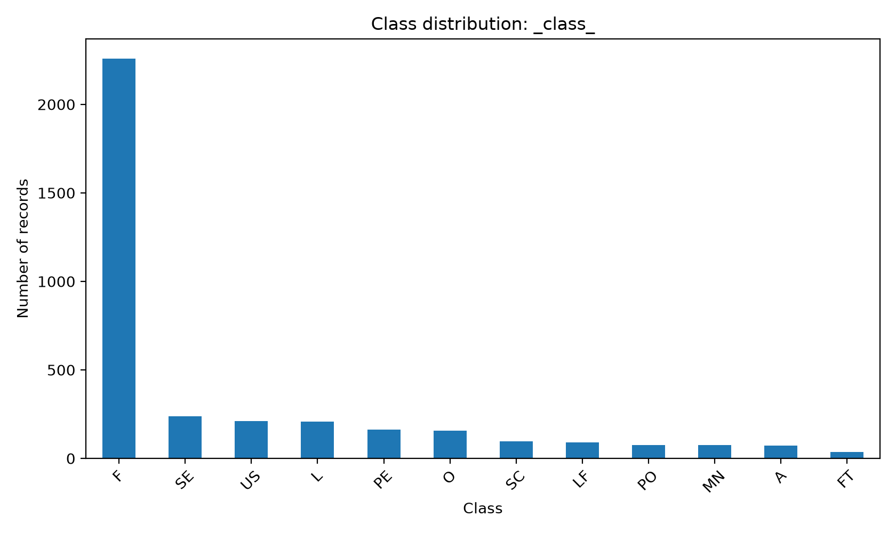
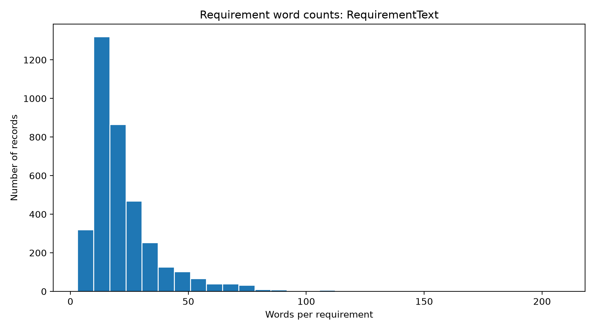

Phase 1 focuses on understanding dataset structure, validating the ARFF file, investigating data-quality issues, and generating statistical summaries and visualizations.

### 1. Dataset Validation and Repair

The original ARFF dataset contained formatting issues that prevented direct loading using the Python ARFF parser.

The validation process identified and corrected:

| Repair type | Count |
|---|---:|
| Missing-comma repairs | 969 |
| Legacy punctuation replacements | 50 |
| Unique modified source lines | 969 |
| Successfully parsed records | 3,677 |

The punctuation replacements were inferred from apparent legacy Windows-1252 character representations.

All modifications were applied to a separate working copy.

**Validated dataset:** `promise_exploration_phase_1/outputs/validated/Promise+_repaired.arff`

**Repair audit:** `promise_exploration_phase_1/outputs/reports/arff_repair_audit.csv`

The original dataset remains unchanged.

### 2. Dataset Quality Analysis

| Metric | Result |
|---|---:|
| Total requirements | 3,677 |
| Unique requirement texts | 3,580 |
| Missing values | 0 |
| Blank requirement texts | 0 |
| Exact duplicate excess records | 21 |
| Normalized duplicate excess records | 113 |
| Distinct repeated texts across projects | 89 |
| Text groups with conflicting labels | 4 |
| Records involved in label conflicts | 8 |

Duplicate counts depend on the comparison method. Normalized duplicates are identified using case and whitespace normalization.

Four normalized-text groups were assigned multiple requirement-class labels. These cases have been flagged for manual review, with their original annotations preserved.

Such disagreements may reflect classification ambiguity or annotation inconsistencies. They do not, by themselves, demonstrate semantic contradictions between software requirements.

### 3. Requirement Class Distribution

The dataset contains 12 observed requirement categories.

| Class | Count | Percentage |
|---|---:|---:|
| F | 2,258 | 61.41% |
| SE | 237 | 6.45% |
| US | 212 | 5.77% |
| L | 209 | 5.68% |
| PE | 163 | 4.43% |
| O | 157 | 4.27% |
| SC | 95 | 2.58% |
| LF | 89 | 2.42% |
| PO | 76 | 2.07% |
| MN | 75 | 2.04% |
| A | 71 | 1.93% |
| FT | 35 | 0.95% |

Functional requirements (`F`) account for 61.41% of the dataset. The smallest class (`FT`) accounts for only 0.95%.

This imbalance will be considered during future model development and evaluation.

### 4. Requirement Text Analysis

The analysis examines the length of software requirements using character counts and whitespace-based word counts.

| Statistic | Characters | Words |
|---|---:|---:|
| Mean | 142.85 | 22.69 |
| Standard deviation | 101.72 | 16.18 |
| Minimum | 26 | 3 |
| 25th percentile | 78 | 13 |
| Median | 112 | 18 |
| 75th percentile | 169 | 27 |
| Maximum | 1,136 | 208 |

The median requirement contains 18 words, while the maximum contains 208 words.

